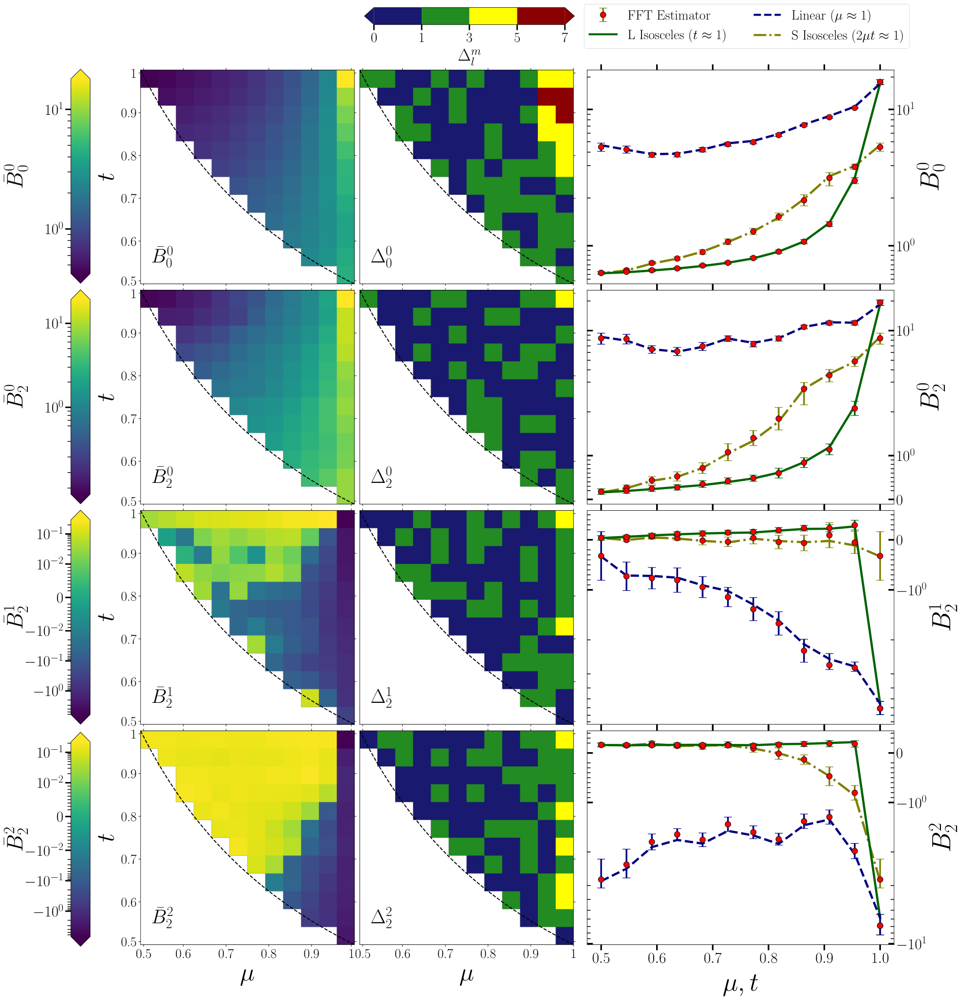

# BARBIE
## Brisk estimator for Angular multipoles of Redshift space BIspEctrum. 
### It takes the 3D cube of galaxy field and computes the all multipole moments of redshift space bispectrum. The redshift space distortion is assumed to be in z direction.

[Paper](https://doi.org/10.1103/PhysRevD.111.043507) · [arXiv](https://arxiv.org/abs/2405.14513) · [Installation](docs/INSTALL.md) · [Code review](docs/REVIEW.md)

BARBIE estimates angular multipoles of the redshift-space bispectrum of a gridded three-dimensional field, including azimuthal modes with $m\ne0$. It organizes Fourier modes into planes normal to a fixed line of sight and concentric rings within each plane. Two-dimensional FFTs accelerate triangle sums, which are then combined into bins of triangle size, shape and orientation.

**Build checked:** the selected root Makefile targets compile on Linux/GCC; compiler warnings and runtime issues remain. See [build log](docs/build.log).

**Status:** documented research-code snapshot. The paper describes and validates the method; this uploaded implementation still has the release blockers listed in [REVIEW.md](docs/REVIEW.md). It is not a galaxy-catalog reader or a survey-window-corrected estimator. The arXiv paper uses the name **BEAM**; **BARBIE** is the repository name used here.


*Published validation, Figure 4 of arXiv:2405.14513v2. This is a paper figure, not a new run of this code. [Attribution](docs/figures/ATTRIBUTION.md).*

## Scientific quantities

For a closed Fourier triangle,

$$\mathbf{k}_1+\mathbf{k}_2+\mathbf{k}_3=0,\qquad B^s=V^{-1}\langle\Delta^s(\mathbf{k}_1)\Delta^s(\mathbf{k}_2)\Delta^s(\mathbf{k}_3)\rangle.$$

With ordered lengths $k_1\ge k_2\ge k_3$, define

$$t=k_2/k_1,\qquad \mu=-\hat{\mathbf{k}}_1\cdot\hat{\mathbf{k}}_2,\qquad \tfrac12\le\mu,t\le1,\quad 2\mu t\ge1.$$

Here $\mu$ describes **triangle shape**, not the cosine of a mode with the line of sight. In the paper's convention,

$$\bar B_\ell^m=\sqrt{\frac{2\ell+1}{4\pi}}\int d\Omega_{\hat p}\,Y_\ell^{m*}(\hat p)B^s(\hat p,k_1,\mu,t).$$

The finite-grid estimator uses discrete orientation weights and a discrete normalization; compare to the corresponding discrete prediction rather than assuming it equals the continuum integral. The current coefficient routine has 16 components: $(\ell,m)=(0,0),(2,0\ldots2),(4,0\ldots4),(6,0\ldots6)$; extending this requires code changes, not just increasing `npoles`.

## Install and build

```bash
sudo apt install build-essential libfftw3-dev libgsl-dev
# After the repository is published:
git clone https://github.com/sukhdeepsinghgill/BARBIE.git
cd BARBIE
make
```

This builds `barbie`, `field` and `calpow_mom`. FFTW3 with its OpenMP backend and GSL are required. MPI is not needed for these targets. [Custom-prefix and platform instructions](docs/INSTALL.md).

## Input contract

`barbie` reads `field_N<NN>_R<realization>.txt` **from its working directory**. Despite `.txt`, it is a raw native-double binary file containing an FFTW in-place real-to-complex buffer of shape `NN × NN × (NN+2)` for even `NN`. It contains Fourier coefficients, not an ASCII table or an untransformed density cube. The last dimension stores interleaved real/imaginary components of the half spectrum.

The generator writes that file to `ResFiles_N<NN>/data_files/` instead. Its filename, data layout, FFT convention, physical cell size and field normalization must match the estimator. No external field adapter or catalog-to-grid pipeline is supplied.

## How to run

**Resolve the review blockers before using output scientifically.** The following shows the actual interface and directory preparation; it is not a completed reproduction test.

```bash
# Run from the repository root, after make.
mkdir -p ResFiles_N384/data_files
./field 384 1
# The current reader expects the file in this directory:
ln -s ResFiles_N384/data_files/field_N384_R1.txt field_N384_R1.txt
./barbie 384 1 51 1 1
```

The five estimator arguments are:

| Argument | Meaning | Example |
|---|---|---|
| `NN` | Even cubic grid size | `384` |
| `NRi` | Realization identifier used in filenames | `1` |
| `UL_k1` | Upper size-bin boundary, in Fourier grid units | `51` |
| `LL_k1` | Lower size-bin boundary, in Fourier grid units | `1` |
| `BW_k1` | Size-bin width, in Fourier grid units | `1` |

Use positive width, `UL_k1 > LL_k1`, and a range exactly divisible by the width. Physical wavenumbers are obtained using `Cunits = 2π/(NN*LL)`. `LL` is cell size, so the box side is `NN*LL`. The hard-coded ring extent must respect the paper's grid/aliasing restriction; reducing `NN` alone is **not** a safe small demo.

The example is a large research workload. Cached plane-ring data alone scale approximately as `16*Nmax*Nr*NN²` bytes: about **8.8 GiB** at `NN=384`, `Nmax=100`, `Nr=40`, before other data and memory. Three stack buffers alone use about 6.75 MiB; check stack and RAM limits.

## What can I change?

| Setting | Where | Uploaded value / effect |
|---|---|---|
| Grid, realization, size-bin limits/width | Command line | Five arguments above |
| `LL` | `barbie.c` | `1.0`; controls physical k and volume normalization |
| `Nthreads` | `barbie.c` | `4`; overrides a simple expectation that `OMP_NUM_THREADS` alone controls the run |
| `Nmax`, `Nr` | `barbie.c` | `100`, `40`; plane/ring geometry and disk use |
| `n_mtbin` | `barbie.c` | `5` bins on each shape axis |
| `npoles` and multipole weights | `barbie.c`, `funcs.c:cal_coeff` | 16 fixed coefficients |
| Ring edges | `barbie.c` | Piecewise widths in blocks of ten; modify coherently with `Nr` |
| Test field `LL`, `ff`, `beta`, seed | `generate_field.c` | `0.56`, `0.5`, `1.0`, `100020+146*NRi` |
| Analytic comparison `ff`, `beta`, input PS | `barbie.c`, `funcs.c` | Estimator currently uses `ff=0.1`, `beta=1`; reconcile with generator |

Rebuild after editing C. Regenerate caches whenever geometry, input field or its normalization changes. Cache names do not encode every scientific setting, so stale caches can silently contaminate a comparison. Keep each configuration in a separate run directory.

## Outputs

`ResFiles_N<NN>/BS_test_ii<index>_N<NN>_R<NRi>.txt` has six columns:

| Column | Meaning |
|---|---|
| 1–3 | Zero-based size, t and μ bin indices |
| 4 | Estimated multipole after code normalization |
| 5 | Analytic-comparison accumulator after normalization; currently unreliable until initialized correctly |
| 6 | Multipole-dependent normalization divided by `NN²`; not a universal triangle count for every multipole |

Index mapping: `0→(0,0)`, `1–3→(2,0–2)`, `4–8→(4,0–4)`, `9–15→(6,0–6)`. Timing logs and geometry/plane-ring caches are written under the same `ResFiles_N<NN>` tree. Verify each multipole denominator before interpreting finite or NaN outputs.

## Repository map

| Path | Purpose |
|---|---|
| `barbie.c`, `funcs.c` | Reference entry point and supporting routines |
| `generate_field.c`, `ngrf_2d_funcs.c` | Synthetic test-field generator |
| `calpow_mom.c`, `wrapid.c` | Auxiliary analysis/precomputation code |
| `Other_Versions/` | Historical implementations, including MPI variants; not in the root build |
| `docs/` | Installation, review, provenance and paper figure |
| `Makefile` | Portable root build; original makefile retained in `docs/legacy_makefile.txt` |

## Citation and support

Sukhdeep Singh Gill and Somnath Bharadwaj, *Brisk estimator for the angular multipoles of the redshift space bispectrum*, Physical Review D **111**, 043507 (2025), [doi:10.1103/PhysRevD.111.043507](https://doi.org/10.1103/PhysRevD.111.043507). See `CITATION.cff`.

For issues, include the commit, compiler, parameters and a minimal input. Read [CONTRIBUTING.md](CONTRIBUTING.md) and [LICENSE_STATUS.md](LICENSE_STATUS.md); a software license has not yet been assigned.
